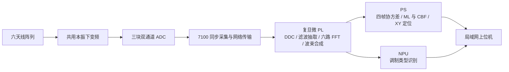

# 复旦微 FPGA SoC 多径 ML–CBF 联合测向与调制识别系统

**FMSH-ML-CBF-AOA · V2.0**

## 项目概述

本项目是一套将六天线阵列、FPGA 信号处理与端侧神经网络推理结合起来的无线信号实验系统。它从真实射频接收链获取数据，完成调制类型识别、来波方向估计和二维交叉定位，并通过局域网上位机呈现处理结果。项目的重点是打通从天线、采样、板端计算到结果复核的完整链路，同时研究多径条件下方向估计的稳定性。

系统由 **7100 采集平台、复旦微 FPGA SoC 处理平台和电脑上位机** 组成。六路接收信号经过共用本振下变频，由三块双通道 ADC 采样；7100 负责采集缓存和网口传输。复旦微 PL 完成数字下变频、滤波抽取、六路独立 FFT 以及波束合成，PS 负责采集调度、通道补偿加载和测向/定位计算，NPU 负责调制类型识别。上位机主要承担显示、控制和按需归档，核心测向算法在板端运行。

测量分为两个独立模式：**ANGLE** 使用六天线整体的复数观测，以多径最大似然估计（ML）和常规波束形成空间谱（CBF）联合选择方向；**POSITION** 将阵列划分为两组三天线，分别估计来波方向，再通过有效射线交点给出 XY 位置。调制识别使用同批四帧 PL 波束合成 I/Q，当前支持 FM、AM、CW、NOISE、OOK、PM 六类。识别与测量结果通过采集批次标识关联，界面区分同批结果与历史识别。

项目重点研究 **静止信号源下，多径拟合的“最强方向”仍出现大幅跳变** 的情况。在噪声、通道误差和相近角度分量共同作用下，多组不同角度可能给出接近的拟合残差，只保留其中一组容易使结果随微小扰动切换。因此，现行方案保留多种低残差解释，再结合同批 CBF 空间谱选择其中的路径，而不是仅对已经跳变的角度做平滑。

为了让问题能够复现，系统还提供按需原始归档：7100 的六路 ADC 数据、复旦微 PL 输出及同批 PS 结果可以配对保存到电脑，再由同版算法回放。归档默认关闭，正常测量不承担原始数据打包和回传开销。

## 系统架构



| 层级 | 主要职责 |
| --- | --- |
| 射频与采样 | 六天线接收、共用本振下变频、三块双通道 ADC 采样 |
| 7100 | 六路采集缓存与网络数据传输 |
| 复旦微 PL | DDC、滤波抽取；六路 FFT 前的启动段屏蔽与加窗；波束合成 |
| 复旦微 PS | 数据与任务调度、补偿参数管理、四帧融合、ML/CBF 测向、两组交叉定位 |
| NPU | 量化模型推理与六类调制识别；特征预处理和任务调度由 PS 完成 |
| 上位机 | 测量显示、波束方向预览与控制、频谱/瀑布观测、调试归档及离线回放 |

多个上位机可以同时订阅复旦微推送的同一份结果。正常采集时，由复旦微统一请求 7100，网页刷新和多端查看不会分别向 7100 发起采样。

## 数学原理概览

### 1. 用六路复数观测描述多径信号

对于同一个目标频点，把六路已补偿 FFT 的复数值组成空间观测向量。窄带平面波模型可简写为：

$$
\mathbf y_{t,b}=\mathbf A(\boldsymbol\Theta)\boldsymbol\alpha_{t,b}+\mathbf n_{t,b},
\qquad
\mathbf A(\boldsymbol\Theta)=[\mathbf a(\theta_1),\ldots,\mathbf a(\theta_K)].
$$

其中，$t$ 表示帧，$b$ 表示选取的频点，$\boldsymbol\Theta$ 是来波角度组合，$\boldsymbol\alpha$ 是各路径的复幅度，包含幅度和相位。当前测角分别搜索 $K=1,2,3$ 三种模型。

对沿 X 轴排列的阵列，以正前方 +Y 为 $0^\circ$，导向向量的第 $m$ 项可表示为 $a_m(\theta)=\exp[j\,s\,2\pi(x_m-\bar x)\sin\theta/\lambda]$。$s$ 是与接收链约定一致的相位符号，$\lambda=c/f_{\rm RF}$ 使用**射频波长**，而不是下变频后的中频波长。相同频点上的通道相对相位提供方向信息，复数幅度同时影响多径的叠加和拟合。

### 2. 四帧融合空间结构

直接相加四帧复数，可能因帧间公共相位变化而相互抵消。当前实现先对每帧空间能量归一化，再计算短批次协方差：

$$
\mathbf R_b=\frac{1}{T}\sum_{t=1}^{T}
\frac{\mathbf y_{t,b}\mathbf y_{t,b}^{H}}{\|\mathbf y_{t,b}\|_2^2},
\qquad T=4.
$$

随后提取主特征向量，构造融合空间观测 $\widetilde{\mathbf y}_b$，并与末帧的公共相位和能量尺度对齐。这样利用的是四帧间较稳定的空间结构，而不是平均四个最终角度。当前窗口限定为**本批四帧**，没有跨批无限累积，也没有把它写成完整协方差随机 ML 求解。

### 3. ML 保留多组低残差解释

在白噪声近似下，确定性 ML 可以写成复数最小二乘。对每组候选角度，求其复幅度，使归一化残差尽量小：

$$
r_K(\boldsymbol\Theta)=
\frac{\displaystyle\min_{\{\boldsymbol\alpha_b\}}
\sum_{b\in\mathcal B}\|\widetilde{\mathbf y}_b-
\mathbf A(\boldsymbol\Theta)\boldsymbol\alpha_b\|_2^2}
{\displaystyle\sum_{b\in\mathcal B}\|\widetilde{\mathbf y}_b\|_2^2}.
$$

$\mathcal B$ 是共同选取的目标频点集合。实现通过 QR 投影计算残差，避免直接对病态正规方程求逆。单径、双径、三径各自先完成搜索，**分别按原始残差保留最多 30 组候选**；CBF 不提前参与修改这批候选。

残差描述的是“这组角度能解释多少当前观测”，并不直接证明它就是实际传播路径。增加路径数通常会增加拟合自由度；相近或相似的导向向量也可能让不同角度组得到接近的残差。这正是不能只凭一次最小残差和拟合幅度决定最终方向的原因。

### 4. CBF 提供同批空间功率参照

CBF 对假设方向施加共轭导向权重，把六路复数相干合成，再累加功率：

$$
P_{\rm CBF}(\theta)=\frac{1}{T M^2}
\sum_{t=1}^{T}\sum_{b\in\mathcal B}
\left|\mathbf a^H(\theta)\mathbf y_{t,b}\right|^2,
\qquad T=4,\ M=6.
$$

这里使用的是**同批四帧、协方差融合前的已补偿复 FFT**，幅度和相位均被保留。空间谱在 PS 上计算，不需要为每个角度重新采样或反复切换 PL。当前先进行粗网格搜索，再做局部细化和正弦空间连续寻峰，得到空间谱主峰方向 $\theta_s$。

CBF 的峰位是整体合成功率的峰位，也会受到反射叠加和阵列旁瓣影响。因此，它是联合选解的参照，不被直接等同于真实直达方向。

### 5. 联合评分选路径，直接输出 ML 候选角

对保留的每组 ML 解及其组内路径，综合解释能力和与 CBF 主峰的匹配程度。当前配置为：

$$
S(\boldsymbol\Theta,\theta)=
0.25\,[1-r_K(\boldsymbol\Theta)]
+0.75\,\exp\!\left[
-\frac{(\sin\theta-\sin\theta_s)^2}{2(0.05)^2}
\right].
$$

第一项衡量整组 ML 解的拟合程度，第二项衡量其中这条路径与 CBF 主峰的方向一致性。匹配在 $u=\sin\theta$ 空间连续降权，$0.05$ 是无量纲宽度，**不是固定的角差硬门限**。权重是当前验证后采用的工程配置，评分也不是概率。

系统遍历候选并取最高分，最终直接输出对应的 **ML 候选角**，不计算两个角度的加权平均。CBF 次峰与所选 ML 组中剩余路径的匹配度只作显示，不参与主方向否决。

ML 与 CBF 来自同一批六路数据，二者没有增加独立测量信息；它们通过不同的评价准则相互约束。该方案仍可能受到近角多径、旁瓣、近场传播和通道误差影响，不能据此承诺消除所有跳变。连续 CBF 峰位的小数也不等于最终 ML 网格角具有同等精度。

### 6. 定位与调制识别的处理

**POSITION 独立于上述六天线联合选角。** 两组三天线分别拟合两条来波路径，形成最多 $2\times2=4$ 个射线交点。经过原有拟合质量、原帧/末帧残差和交会几何检查后，按两组所用路径的能量份额乘积选择有效交点。当前不再用联合测角与角差加权牵引 XY 位置。

**调制识别使用另一条输入分支。** PS 对四帧 PL 波束合成 I/Q 进行启动段处理和公共幅度尺度调整，提取时频、频谱及序列特征，再调度经过 Icraft 转换、量化和编译的模型在 NPU 上推理。测向中的 ML 指最大似然估计，与这里的神经网络分类是两种不同方法。

## 为什么选择 ML–CBF 联合方案

**需要显式解释多径，也需要在相近解释之间做选择。** 单一方向假设难以描述直达与反射的相干叠加，多径 ML 可以在同一模型内拟合多条路径；但只输出一组最小残差解，会过早丢掉其他可能正确的解释。保留候选池，使后续选择仍有机会找到与整体空间响应一致的路径。

**同批 CBF 计算成本较低，且能保留另一种评价视角。** 它复用已采集的六路复 FFT，以合成功率观察空间响应，无需逐角重新请求 ADC。当前采用完整幅相和粗到细寻峰，不把只相位处理或理论方向图误当成新增实测信息。

**直接选择可解释的路径，比输出折中角更符合当前目标。** 当 ML 和 CBF 分别指向不同分量时，两个角度的平均值未必对应任何真实路径。现行方法让 CBF 帮助选择 ML 候选，保留该角度所属的多径组合与残差信息，便于结合原始数据分析原因。

**方案还需要适合板端计算和可重复验证。** PL 承担规则、并行的数据处理，PS 承担候选搜索和组合判定，NPU 承担调制分类；配对归档把不同阶段的数据关联起来，能够在电脑重放同一批输入，核对修改来自算法、数据链还是硬件。

这些取舍形成了现行实现，并不意味着联合方案在所有场景都优于纯 CBF。已有验证支持它在部分场景下改善选解稳定性，精度与鲁棒性仍需结合阵列、信号和传播环境评估。

## 关键尝试与方案演进

项目围绕“静止信号源仍出现估计跳变”的问题，做过以下直接影响当前方案的尝试：

| 尝试 | 主要认识 | 当前取舍 |
| --- | --- | --- |
| 多径 ML 最小残差与最大拟合幅度选径 | 低残差可能对应多组不同角度；微小扰动会改变最优解释和拟合幅度排序，不一定是实际直达信号变弱 | 保留 ML 建模，不再只取唯一最优组中的最大幅度路径 |
| 去直流、启动段屏蔽、加窗与通道补偿 | 数据预处理和通道一致性必须先处理；算法不能替代对接收链路的核对 | 纳入当前链路，补偿以独立文件管理 |
| 多帧复数平均与协方差融合比较 | 直接复数平均受公共相位影响；短窗口空间协方差在已有回放中更可靠 | 当前使用本批四帧归一化协方差主向量构造融合观测 |
| 单/双/三径级联、残差复核和低阶候选回查 | 模型阶数、残差与角度一致性不能简单互相替代；过早否决候选可能丢掉可用路径 | 现行 ANGLE 分阶保留多组低残差解，再统一软匹配 |
| 逐方向 PL 实扫与同批复 FFT 等效计算 | 实扫可用于对照，但逐角采集较慢，且不同角度的采集时间不同 | 在线采用 PS 同批全复数 CBF 和精细寻峰，不逐角重采 |
| 固定 CBF 80% / ML 20% 的角度融合 | 可作为比较基线，但折中角未必属于任一传播分量 | 改为从 ML 候选中选择路径，不对两个角求平均 |
| 测向预处理/重排 MLP、学习融合权重 | 仿真和部分回放出现条件性收益，但对数据分布敏感；只学习两个角的权重也难以修复共同选错 | 未替代当前测角主链路；这与已部署的 NPU 调制识别无关 |
| 只相位响应、幅度加窗与旁瓣抑制 | 改变权重不等于增加独立信息；压旁瓣会影响主瓣和有效孔径，当前阵列不能直接套用理想等距阵列结论 | 当前保留均匀权重全复数 CBF，其他方法留作研究 |
| 路径关联与切换迟滞 | 可约束输出切换，但不直接解决当前帧为何拟合成另一组角度的问题 | 当前版本不启用跨批路径跟踪或切换迟滞 |
| 联合测角参与 XY 交点加权 | 部分现场情况下，联合角偏差会把定位拉向错误交点 | POSITION 回退并保持原两组三天线 ML 能量选点，ANGLE 保留联合方案 |

当前 V2.0 因而采用 **四帧空间融合 + 分阶 ML 候选池 + 同批精细 CBF 软匹配** 的测角流程，同时保留独立的两组 ML 定位和 NPU 调制识别。研发过程中强调区分仿真真值、实测稳定性和实际角度精度，不把“曲线更平稳”直接当作“方向更准确”。

## 主要功能

| 功能 | 当前实现 |
| --- | --- |
| 六路采集 | 三块双通道 ADC；12 位补码恢复、逐路去直流 |
| PL 预处理 | DDC、滤波抽取；六路独立 FFT 屏蔽前 64 点，对 4032 点加 Hann 窗，输出 4096 点 FFT |
| 测角 ANGLE | 单/双/三径最大似然（ML）低残差候选，与同批常规波束形成（CBF）空间谱软匹配，输出选中的 ML 角度 |
| 定位 POSITION | 两组三天线 ML、四帧协方差与交叉定位；保留几何和质量检查，按有效交点的路径能量选点 |
| 调制识别 | 四帧 PL 波束合成 I/Q 输入 NPU；FM、AM、CW、NOISE、OOK、PM |
| 波束控制 | 手动滑条与数值输入即时预览，点击 `APPLY` 后下发 PL，并校验寄存器回执 |
| 观测 | 合成 I/Q 波形、完整 4096 点复 FFT、频谱瀑布；独立使能 |
| 调试归档 | 原始 ADC、PL 输出与同批 PS 结果配对保存到电脑，支持离线回放 |

POSITION 与 ANGLE 保持独立：XY 定位不受六天线联合测角结果牵引；次方向匹配只用于显示。

## 使用与部署

[Release](https://github.com/fornesen/FMSH-ML-CBF-AOA/releases/latest) 只交付一个 **`AOA_System_V2.0.zip` 完整部署包**，包含一个电脑上位机、复旦微自包含运行目录、7100 启动镜像及集中使用说明。原始 ADC 查看器只保留在源码中，不放入部署包。

解压后双击根目录 `start_pc.cmd`，按启动窗口显示的地址打开网页。复旦微的安装、自启动、模式选择、波束控制及调试归档操作统一见 [使用说明](Documentation/GETTING_STARTED.md)。

**调试归档默认关闭。** 关闭时不产生新的原始归档，也暂停后台打包、校验及后续原始数据发送；正常测量继续。开启后数据保存在电脑，板端只使用有上限的 RAM 暂存。

## 源码组织

```text
FPGA/             两块板的原始 Vivado / SDK 工程
  7100/           六路 ADC 采集与网络传输
  Fudan/          DDC、抽取、FFT、波束合成
PS/               测角、定位、NPU 及板端校准源码
PC/
  Console/        唯一主上位机，含内部归档与回放支持
  adc_monitor/    原始 ADC 查看器，仅供开发排查
Board/            当前配置、运行管理及自启动服务
common/           板端和电脑共用的数据格式与工具
Documentation/    集中的使用、构建和技术说明
tools/            必要构建辅助工具
tests/            当前有效的跨模块测试
```

原始工程直接保留在这些源码目录中，不再分别发布多个工程压缩包。第三方 IP、BSP 和许可证保留原有结构。模型、位流、私有运行库及 Windows Python 放在完整工程的 `assets/`、`dependencies/` 中，编译和打包时读取，二进制依赖不重复写入 Git 历史。

源码中的 `start_adc_viewer.cmd` 用于独立检查 7100；它会主动请求采样，使用时应先停止复旦微采集。日常使用只启动主上位机。

## 构建与维护

- [构建和板端部署](Documentation/BUILD_AND_DEPLOY.md)
- [数据链路](Documentation/DATA_FLOW.md)
- [算法](Documentation/ALGORITHMS.md)
- [FPGA 工程重建](Documentation/FPGA.md)
- [通道校准](Documentation/CALIBRATION.md)
- [NPU 识别与训练](Documentation/NPU.md)
- [调试归档和离线回放](Documentation/RECORDING_AND_REPLAY.md)

`package_release.py` 生成唯一完整部署包。使用说明集中于 `Documentation/`。
